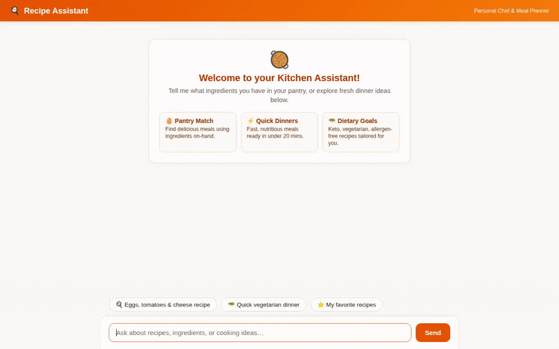

# 🍳 Recipe Assistant

A conversational culinary assistant built on Google Agent Development Kit (ADK) and Gemini that helps home cooks create delicious meals from on-hand ingredients, manages recipe favorites, renders rich interactive cards via A2UI, and generates realistic food visuals.



---

## 🌟 What This Agent Does

Recipe Assistant is wired with Google Cloud services and the Google GenAI SDK to deliver an end-to-end kitchen copilot experience:

1. **Pantry Ingredient Matching**: Matches user-provided pantry ingredients against a catalog of recipes, ranking dishes by matched ingredient count and surfacing missing items.
2. **Interactive A2UI Recipe Cards**: Emits structured Agent-to-UI (A2UI) component surfaces that render rich cards with headers, food imagery, cooking times, difficulty tags, and step-by-step instructions.
3. **Cross-Session Long-Term Memory**: Automatically extracts and retains user dietary goals, allergies, favorite cuisines, and household preferences across conversations using Vertex AI Memory Bank.
4. **Food Photography Generation**: Creates plated culinary visuals on demand using Google's `gemini-3.1-flash-lite-image` model, saving them as playground session artifacts and hosting them on public Google Cloud Storage.
5. **Short Culinary Video Generation**: Generates 720p cooking and plating videos using Google's `gemini-omni-flash-preview` model, saving artifacts to the session and uploading directly to Google Cloud Storage.
6. **Ingredient Substitutions & Online Search**: Provides instant culinary substitutes for common missing ingredients and queries TheMealDB API for dish ideas.
7. **Nearby Grocery Search**: Geocodes locations and queries Google Places API for nearby supermarkets and specialty grocery stores.

---

## ☁️ Google Cloud Services & Tools Wired Up

The agent code in [`app/agent.py`](app/agent.py) implements and registers the following integrations:

| Service / Capability | Implementation & Model / API | Description |
| :--- | :--- | :--- |
| **Foundation Model** | `gemini-3.8-flash` via `google-adk` | Core reasoning and conversational orchestration. |
| **Vertex AI Memory Bank** | `PreloadMemoryTool` + `generate_memories_callback` | Long-term memory extraction and cross-session persistence via `add_session_to_memory()`. |
| **Cloud Firestore** | `google-cloud-firestore` (`recipes` collection) | Stores recipe catalog, full instructions, prep times, and favorite flags. |
| **Cloud Storage** | `google-cloud-storage` | Public bucket storage for generated food photography and cooking videos. |
| **Image Generation** | `gemini-3.1-flash-lite-image` (Global region) | Generates food imagery saved via `tool_context.save_artifact` and uploaded to Cloud Storage. |
| **Video Generation** | `gemini-omni-flash-preview` (Global region) | Generates short 720p culinary videos saved via `tool_context.save_artifact` and uploaded to Cloud Storage. |
| **Rich UI (A2UI)** | `a2ui_callback` + `A2UI_INSTRUCTION` | Emits A2UI component payloads (Cards, Columns, Images, Text) for native frontend rendering. |
| **External Recipes** | TheMealDB REST API (`search_online_recipes`) | Searches public culinary recipes by dish title or keyword. |
| **Google Maps** | Geocoding API (`geocode_address`) | Converts addresses into latitude and longitude coordinates. |
| **Google Places** | Places API New (`find_nearby_places`) | Searches nearby grocery stores and supermarkets by geographic radius. |

> **Planned, Not Yet Implemented:**
> - Code Sandbox execution for dynamic ingredient scaling and automatic recipe nutrition calculation (planned in the original brief, not yet implemented in agent tools).

---

## 🛠️ Repository Structure

```
recipe-assistant/
├── app/
│   ├── __init__.py
│   ├── agent.py               # Main ADK root_agent, tools, callbacks, and configuration
│   ├── a2ui_instruction.py    # A2UI prompt instructions for rendering rich cards
│   └── a2ui_utils.py          # A2UI response formatting callback
├── frontend/
│   ├── main.py                # FastAPI proxy connecting browser to deployed agent
│   ├── requirements.txt       # Frontend dependencies (FastAPI, uvicorn, httpx, google-auth)
│   └── static/
│       ├── index.html         # Custom chat UI with terracotta branding and quick prompts
│       ├── a2ui.js            # Client-side renderer for A2UI cards
│       ├── main.js            # Chat stream handling and UI interactions
│       └── style.css          # Styling for culinary dialogue layout and cards
├── agents-cli-manifest.yaml   # Deployment manifest targeting Agent Runtime
├── pyproject.toml             # Python project metadata and dependencies
└── demo.gif                   # Looping recording of the agent in action
```

---

## 🚀 Running Locally

Follow these steps to run the agent and frontend on your local development machine:

### 1. Prerequisites

- Python 3.10+
- Google Cloud SDK (`gcloud`) authenticated to your GCP project:
  ```bash
  gcloud auth application-default login
  ```

### 2. Run the Agent with ADK Web Playground

To test the agent locally using the ADK interactive developer interface:

```bash
cd recipe-assistant
pip install -e .
adk web app:app
```

The ADK development interface will start, allowing you to test tools, inspect long-term memories, and review generated artifacts.

### 3. Run the Custom Frontend

To run the full chat web interface locally with its FastAPI proxy:

```bash
cd recipe-assistant/frontend
python3 -m venv .venv
source .venv/bin/activate
pip install -r requirements.txt

# Set the environment variables pointing to your agent deployment
export AGENT_ENGINE_RESOURCE_NAME="projects/<PROJECT_ID>/locations/<REGION>/reasoningEngines/<ENGINE_ID>"
export AGENT_DIRECTORY="app"

python3 main.py
```

The server will launch locally on port 8080.
